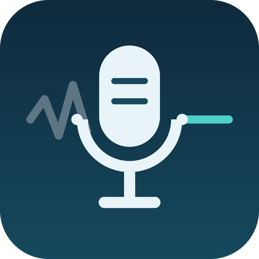

# Clean Mic



A [Decky Loader](https://github.com/SteamDeckHomebrew/decky-loader) plugin that gives SteamOS and Linux handhelds and desktops a **noise-cancelled virtual microphone**. Turn it on in the Quick Access menu and a new input device appears: **"Clean Mic (noise-cancelled)"**. Pick it in Discord, OBS, Deck Live or a browser, or make it the default mic so Steam voice chat uses it too.

> **Status: 0.1.0, pre-release.** Built and tested against PipeWire 1.4. It hasn't been verified on a Legion Go or an NVIDIA Bazzite machine yet. No release has been published, so install from the test zip (see below).

## How it works

```
your mic ──► [ pipewire -c ~/homebrew/settings/clean-mic/clean-mic.conf ]  (separate process, runs as you)
               filter-chain: RNNoise (system librnnoise_ladspa.so) ──► "Clean Mic" (Audio/Source)
                                                                          │
                       Discord / OBS / Deck Live / Steam voice ◄──────────┘
```

- **Engine:** [RNNoise](https://github.com/xiph/rnnoise) through werman's [noise-suppression-for-voice](https://github.com/werman/noise-suppression-for-voice) LADSPA plugin, the copy **your OS already ships**. Clean Mic doesn't bundle it.
  - If RNNoise isn't installed, or keeps failing to start, Clean Mic falls back to **PipeWire's built-in WebRTC noise suppression**.
  - The WebRTC fallback also cancels game audio that your mic picks up from the speakers.
- **Separate process:** the filter runs in its own `pipewire -c` client process, so it never restarts your audio server. If it crashes, it can't take game audio down with it.
- **No root and no system changes.** The backend runs as your user (`flags: []`). Its files live only in `~/homebrew/settings/clean-mic/` and Decky's log folder, and nothing goes into `/etc`, `/usr` or `~/.config/pipewire`. It survives SteamOS and Bazzite (rpm-ostree) updates because it never touches the OS image.
- **Game Mode and Desktop Mode.** It uses the same user PipeWire session in both. Decky's menu is only visible in Game Mode, but once Clean Mic is on it keeps running in Desktop Mode. It also comes back after a reboot, or after the audio session restarts when you switch modes.
- **No GPU use.** It's CPU-only (RNNoise uses a few percent of one core), so it doesn't touch VRAM or NVENC on NVIDIA machines.

## Features (0.1.0)

| Control | What it does |
|---|---|
| **Clean Mic** toggle | Creates or removes the virtual mic. Turning it off removes the process and restores your previous default mic. |
| **Strength** (0–100%) | Sets RNNoise's voice gate (0% = denoise only; 70% default = gate 66%; 100% = gate 95%). It applies live, with no audio gap. |
| **Input mic** | Sets the real mic to clean: "System default mic" or a specific device. It follows the default mic if that changes (for example, a USB headset plugged in). |
| **Use as default mic** | Makes Clean Mic the system default input (Steam voice, browsers, etc.). It remembers and restores your previous default. |
| **Engine** | Auto (RNNoise, with the WebRTC fallback), RNNoise only, or WebRTC only. |
| **Record 5 s test** | Records the original and the cleaned mic side by side, then plays either back. |
| **Status / Details** | Shows state, engine, input, whether the output device is present and default, CPU % of one core, uptime and restarts. It warns if your mic is already filtered by the system, to avoid double denoising. |

Failure handling:
- If the filter dies, it respawns after 1, 3 and 10 s.
- After three quick failures it switches to WebRTC. If that fails too, it stops cleanly, puts your default mic back, and shows **Retry**.
- The filter process always dies with the plugin.
- Leftovers from a crashed Decky are cleaned up on the next start.

## Install

You need [Decky Loader](https://decky.xyz). Run these in Konsole (Desktop Mode) or over SSH, as your normal user.

**Test zip (0.1.0, before a release exists):** copy `clean-mic-0.1.0.zip` to the device, then run:

```sh
curl -LO https://github.com/VetTV-Studios/clean-mic/raw/main/install.sh
CLEAN_MIC_ZIP=~/Downloads/clean-mic-0.1.0.zip sh install.sh
```

Or use Decky ▸ Settings ▸ Developer ▸ Install plugin from ZIP.

**Once a release is published:**

```sh
curl -L https://github.com/VetTV-Studios/clean-mic/raw/main/install.sh | sh
```

The installer uses `sudo` only if Decky's plugin folder isn't writable by you (on SteamOS and Bazzite it usually isn't), and to restart Decky. If you never set a password, run `passwd` first. It checks the zip's paths before extracting and swaps the plugin folder atomically.

## RNNoise

Clean Mic looks for `librnnoise_ladspa.so` in `$LADSPA_PATH`, `/usr/lib64/ladspa`, `/usr/lib/ladspa`, `/usr/lib/x86_64-linux-gnu/ladspa`, `/usr/local/lib{,64}/ladspa`, `~/.ladspa` and `~/homebrew/data/clean-mic/ladspa`.

- **Bazzite deck images** (including `bazzite-deck-nvidia`) ship it as `/usr/lib64/ladspa/librnnoise_ladspa.so` through the `steamdeck-dsp` package.
- **SteamOS** uses RNNoise for the Steam Deck's internal mic. Clean Mic checks the path at run time.
- **Other systems:** install your distro's package. On Fedora it's `ladspa-noise-suppression-for-voice`, and on Arch-based systems it's usually `noise-suppression-for-voice`.
- **No package, or an image-based OS you'd rather not layer:** download the official release yourself. No root is needed:

  ```sh
  mkdir -p ~/homebrew/data/clean-mic/ladspa && cd /tmp
  curl -LO https://github.com/werman/noise-suppression-for-voice/releases/download/v1.10/linux-rnnoise.zip
  echo "811390b6eb6e28dde023c70590c74d26e74ebb2e595bcf4b95af2341db160e99  linux-rnnoise.zip" | sha256sum -c
  python3 -m zipfile -e linux-rnnoise.zip rnn && cp rnn/linux-rnnoise/ladspa/librnnoise_ladspa.so ~/homebrew/data/clean-mic/ladspa/
  ```

  That file is GPL-3.0 and stays a separate program on your system. Then press **Retry** in Clean Mic.

Without RNNoise, Clean Mic uses PipeWire's WebRTC module (`aec/libspa-aec-webrtc.so`, part of PipeWire on SteamOS, Fedora and Arch). In that mode the strength slider is disabled.

## Using it with Deck Live

Deck Live 1.x (branch `feature/clean-mic-source`) lists **Clean Mic (noise-cancelled)** in its mic picker. When Clean Mic is selected, Deck Live skips its own `webrtcdsp` noise filter so the voice isn't denoised twice.

## Uninstall

```sh
curl -L https://github.com/VetTV-Studios/clean-mic/raw/main/uninstall.sh | sh            # keep settings
curl -L https://github.com/VetTV-Studios/clean-mic/raw/main/uninstall.sh | PURGE=1 sh    # remove settings and logs too
```

The uninstaller restores your default mic in your audio session first, then stops the filter and removes the plugin. Uninstalling from Decky's own menu does the same through the plugin's uninstall hook.

## Troubleshooting

- **"RNNoise not found":** see [RNNoise](#rnnoise). The WebRTC fallback keeps working meanwhile.
- **Voice sounds choppy or cut off:** lower Strength. 0% still removes noise but never gates.
- **Muffled voice:** your mic may already be filtered by the system (Clean Mic shows a notice). Pick the raw device, or use 40% or less.
- **Logs:**
  - plugin: `~/homebrew/logs/Clean Mic/`;
  - filter process: `pipewire-child.log` in the same folder;
  - generated config: `~/homebrew/settings/clean-mic/clean-mic.conf`.
- **See the device:** `pactl list short sources | grep clean_mic`, or `pw-top` while something is recording.

## Development

```sh
pnpm install && pnpm build          # frontend -> dist/index.js
python3 -m unittest discover -s tests -v
shellcheck -x install.sh uninstall.sh package.sh
./package.sh /tmp/out               # -> /tmp/out/clean-mic-<version>.zip (Decky install-from-zip layout)

# Optional end-to-end test against a running PipeWire session (needs pipewire, wireplumber, pipewire-pulse):
CLEAN_MIC_LIVE=1 LADSPA_PATH=/dir/with/rnnoise python3 -m unittest tests.test_live_pipewire -v
```

Layout:
- `main.py`: Decky backend, process supervisor and default-mic handling.
- `cleanmic.py`: pure logic (engine discovery, config generation, `pw-dump` parsing).
- `src/`: Quick Access panel (`@decky/ui`, `@decky/api`).

Scaffolded from [decky-plugin-template](https://github.com/SteamDeckHomebrew/decky-plugin-template).

## License and credits

Clean Mic is BSD-3-Clause (see [LICENSE](LICENSE)). It distributes no third-party binaries.
- RNNoise: BSD-3-Clause, © Jean-Marc Valin, Mozilla, Amazon.
- [noise-suppression-for-voice](https://github.com/werman/noise-suppression-for-voice): GPL-3.0, by werman. It's loaded from your system by PipeWire, in a separate process.
- [PipeWire](https://pipewire.org): MIT, including its WebRTC echo-cancel module.
